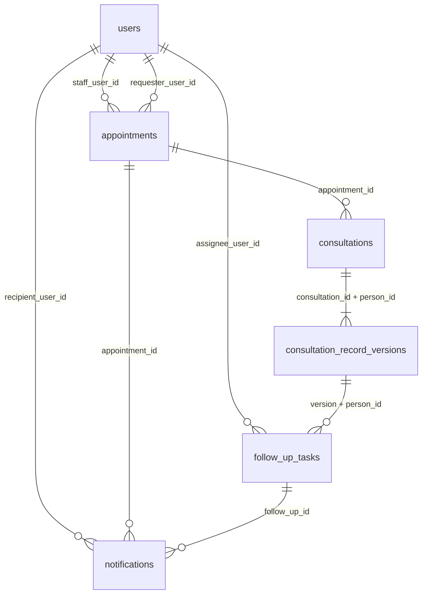

# BE2 데이터베이스 설계

이 문서는 테이블 설계다. 순수 함수의 동작은 각 도메인 문서가 우선한다. 공통 계약은 `docs/contracts.md`가 우선한다.

SQL 초안은 `migrations/drafts/0002_be2_consultations.sql`이다. `scripts/migrate.ts`는 `migrations` 바로 아래의 `NNNN*.sql`만 실행한다. 초안은 그 목록에 없으므로 `pnpm migrate`로 적용되지 않는다.

## 이 브랜치에서 확인한 사실

작업 브랜치는 `feature/be2-db-schema`다. `migrations/`에는 README만 있고 `0001`이 없다.

`main`에는 `migrations/0001_be1_create_users_table.sql`이 있다. 테이블은 `users`, PK는 `user_id uuid`다. `role`은 `patient | family | staff | admin`이다. `status`는 `PENDING | APPROVED | REJECTED`다. 이 파일을 이 브랜치로 복사하거나 병합하지 않았다.

`main`의 SQL에서 `CREATE TABLE`은 `users`뿐이다. `persons` 테이블은 없다. 역할 문서의 `persons`는 제안이다. `person_id`에 외래 키를 만들지 않는다.

`main`의 `src/modules/consultations`는 메모리 배열이다. 예약·상담 테이블이 아니다. `GET /api/consultations/appointments`와 `GET /api/consultations/records`는 `authenticateUser`, `requireApprovedUser`, `requireRole`을 호출하지 않는다. 이 브랜치의 `src/app.ts`에는 그 라우트가 없다. BE1 라우트는 수정하지 않았다.

관계 서비스도 메모리 배열이다. 가족·배정 테이블은 없다.

분석 이벤트 모듈 `analysis-event.ts`는 이 작업 트리에 없다. `5f37ea5`를 읽어 접수 이력 설계만 적었다. 코드를 가져오지 않았다.

## 적용 순서

1. `0001_be1_create_users_table.sql`이 `migrations/`에 있고 먼저 적용되어 있어야 한다. 파일 이름 정렬상 `0001`이 `0002`보다 앞이다.
2. 공통 스키마는 BE1과 영향 도메인의 검토가 필요하다. 그 전이므로 `0002`를 실행 폴더로 옮기지 않는다.
3. 검토 뒤에 초안을 `migrations/0002_be2_consultations.sql`로 옮긴다. 이미 적용된 파일은 고치지 않는다. 러너는 파일 단위로 트랜잭션을 열고, 실패하면 그 파일만 롤백한다.
4. 가능 시간 테이블과 예약 배제 제약은 이 파일에 없다. 정책이 정해진 뒤 다음 번호로 추가한다. 번호를 쓰기 전에 `main`과 열린 브랜치의 `migrations/*.sql`을 다시 확인한다.

실행 중인 데이터베이스에서 이 초안을 되돌려야 하면 다음 순서로 제거한다. 적용된 뒤에는 기존 파일을 수정하지 말고 새 마이그레이션으로 제거한다.

`notifications` → `follow_up_tasks` → `consultation_record_versions` → 트리거 함수 → `consultations` → `appointments`

상담 원문이 들어 있는 환경에서는 이 순서를 실행하지 않는다.

## ERD

`users`만 실제 선행 테이블이다. `person_id`는 속성이다.

## 테이블

UUID 기본 키는 `uuid`다. BE1 `users.user_id`와 같고, 대소문자가 다른 같은 식별자를 한 값으로 본다. 메모리 함수가 보존하는 16진수 철자는 데이터베이스에 남지 않는다.

시각은 `timestamptz`다. 절대 시각만 저장한다. 오프셋 표기는 넣기 전에 API에서 거절한다. 컬럼이 원문 오프셋을 보관하지는 않는다.

삭제는 `ON DELETE RESTRICT`다. 사용자나 예약을 지울 때 상담 원문이 따라 지워지지 않는다. 계정 삭제 정책 자체는 아직 없다.

### appointments

| 컬럼 | 확정 | 제약 |
|---|---|---|
| `appointment_id` | 식별자 | PK |
| `person_id` | 대상자. 사용자 id가 아님 | NOT NULL. FK 없음 |
| `staff_user_id` | 담당 상담사 사용자 | `users.user_id` FK |
| `requester_user_id` | 요청자와 담당자를 구분 | NULL 허용. `users.user_id` FK. 담당자와 같다고 채우지 않음 |
| `starts_at`, `ends_at` | 끝은 시작보다 뒤 | `timestamptz`, CHECK |
| `status` | 비어 있지 않은 문자열 | 상태 이름 CHECK 없음 |
| `created_at`, `updated_at` | 호출자가 넣을 때만 | NULL. 기본값으로 현재 시각을 찍지 않음 |

요청자가 항상 있어야 하는지는 정하지 않았다. 그래서 `requester_user_id`는 NULL이다.

겹치는 예약의 배제 제약은 넣지 않았다. 점유 상태와 차단 관계는 호출자 정책이고, 목록이 비어 있으면 충돌 없음이 아니라 정책 미설정이다. `meets`도 호출자가 넣을 때만 차단이다. 모든 겹침을 `EXCLUDE`로 막으면 그 정책을 확정하게 된다.

동시 예약은 `SELECT` 다음 `INSERT`로 막히지 않는다. 정책이 정해지면 `btree_gist`와 범위 배제 제약을 담당 상담사 축과 대상자 축에, 합의된 점유 상태에만 건다. 그 전에도 인덱스 `(staff_user_id, starts_at)`, `(person_id, starts_at)`는 조회용이다. 배제 제약이 아니다.

### consultations

| 컬럼 | 확정 | 제약 |
|---|---|---|
| `consultation_id` | 상담 식별자 | PK |
| `person_id` | 대상자 | NOT NULL. `(consultation_id, person_id)` UNIQUE. FK 없음 |
| `appointment_id` | 관련 예약은 선택 | NULL 허용. `appointments` FK |

작성자와 작성 시각은 상담 기록 도메인에 아직 필드가 없다. 컬럼으로 만들지 않았다.

### consultation_record_versions

| 컬럼 | 확정 | 제약 |
|---|---|---|
| `record_version_id` | 버전 식별자 | PK |
| `consultation_id`, `person_id` | 상담 헤더와 같은 쌍 | 복합 FK |
| `text` | 원문 | NOT NULL. 길이 상한과 빈 문자열 금지는 없음 |

`UPDATE`와 `DELETE`는 트리거가 거절한다. 수정은 새 `record_version_id`다. 오류 문장에는 원문을 넣지 않는다.

작성 시각, 수정자, 버전 번호는 없다.

BE3는 `consultation_id`와 `record_version_id`로 이 행을 찾을 수 있다. 복합 유니크가 그 쌍을 한 행으로 고정한다.

### follow_up_tasks

| 컬럼 | 확정 | 제약 |
|---|---|---|
| `follow_up_id` | 업무 식별자 | PK |
| `person_id` | 대상자 | NOT NULL. FK 없음 |
| `title`, `status` | 제목과 열린 상태 | `status`는 빈 문자열만 거절 |
| `consultation_id`, `record_version_id` | 둘 다 있거나 둘 다 없음 | CHECK. 있으면 버전·대상자 복합 FK |
| `assignee_user_id` | 담당 사용자. 요청자와 복사하지 않음 | NULL 허용. `users.user_id` FK |
| `due_at`, `created_at`, `updated_at` | 호출자가 넣을 때만 | NULL |

출처와 `person_id`, `follow_up_id`는 이후 `UPDATE`로 바꾸지 못한다. 제목, 상태, 담당자, 기한, `updated_at`은 바꿀 수 있다. 상태 이름 목록은 없다. 기록 없는 업무는 허용된다. 담당자와 기한을 필수로 만들지 않았다.

### notifications

| 컬럼 | 확정 | 제약 |
|---|---|---|
| `notification_id` | 알림 식별자 | PK |
| `recipient_user_id` | 수신 사용자 | `users.user_id` FK |
| `kind`, `title`, `body` | 종류는 열린 문자열. 본문은 표시 문장 | `kind`는 빈 문자열만 거절 |
| `event_id` | 선택 참조 | NULL 허용. UNIQUE 아님 |
| `appointment_id`, `follow_up_id` | 선택 참조 | NULL 허용 FK |
| `person_id` | 대상자 | NULL 허용. FK 없음 |
| `created_at` | 선택 | NULL. 기본 시각 없음 |
| `read_at` | 읽은 시각. 발송 시각이 아님 | NULL이면 읽지 않음 |

`sent_at`과 `delivered_at`은 없다. 상담 원문 컬럼은 없다. `body`에 원문을 복사하지 않는다.

같은 `event_id`의 서로 다른 내용 충돌은 애플리케이션이 기존 행과 비교한다. 데이터베이스는 다른 `notification_id`를 막지 않고, 같은 `notification_id`의 두 번째 행만 거절한다. 충돌 시 기존 행을 갱신하지 않는 규칙은 애플리케이션에 남긴다. 읽음 취소와 삭제는 정책이 없으므로 트리거로 금지하지 않았다.

수신자 인덱스는 사용자별 조회용이다. 권한 검사를 대신하지 않는다. 조회 쿼리는 `recipient_user_id`를 조건에 넣는다.

## 분석 이벤트 접수 이력

이 테이블은 초안 SQL에 넣지 않았다. 발행 형식은 공통 계약의 초안이고, 접수 코드는 다른 브랜치에 있다.

검토한 행 모양은 다음과 같다.

- `event_id uuid` PK
- `event_type text` NOT NULL. `analysis.succeeded`와 `analysis.failed`를 CHECK로 닫지 않음
- `occurred_at timestamptz` NOT NULL
- `analysis_id uuid` NOT NULL
- `consultation_id`, `record_version_id`, `person_id`를 버전 복합 FK로 연결
- 발송 시각 없음
- 행 갱신과 삭제를 거절해 다른 내용이 같은 `event_id`를 덮어쓰지 못하게 함

PK는 같은 `event_id`의 두 번째 삽입을 거절한다. 내용이 같은 재접수와 내용이 다른 충돌의 구분은 삽입 전에 애플리케이션이 한다. 거절된 삽입이 기존 행을 바꾸지는 않는다. 이 접수가 알림을 만들거나 푸시를 보냈다는 뜻은 아니다.

## 가능 시간

테이블을 만들지 않았다. 요일 번호, 시간대 저장, 예외 종류와 우선순위, 자정 넘김이 정해지지 않았다. 상담사 식별자가 필요해지면 `users.user_id`를 참조한다. 별도 상담사 테이블은 만들지 않는다.

## 권한

외래 키는 접근 권한이 아니다. `patient`, `staff`, `admin` 역할과 `users.status`는 행을 읽을 수 있는지가 아니다. 승인, 가족 관계, 배정, 동의는 BE1 권한 계층이 검사한다. 그 테이블은 아직 없다.

초안은 `PUBLIC`의 테이블·함수 권한을 거둔다. 애플리케이션 역할에 권한을 주는 작업은 포함하지 않았다. RLS로 권한 정책을 대신 적지 않았다.

## 검증과 롤백

무결성 확인 SQL은 `migrations/drafts/0002_be2_consultations.checks.sql`이다. 끝에서 `ROLLBACK`한다. 격리된 빈 데이터베이스에서 `0001` 다음에 초안을 적용한 뒤 실행한다. `caregap_local`이나 사용자 데이터가 있는 데이터베이스에는 실행하지 않는다.

초안을 두 번 그대로 실행하면 두 번째는 이미 있는 관계에서 실패한다. 러너가 그 실행을 트랜잭션으로 감싸면 두 번째 시도는 롤백되고 첫 적용은 남는다. 러너는 적용된 이름과 체크섬이 같으면 다시 실행하지 않는다. 적용 뒤에 파일 내용을 바꾸면 체크섬 오류로 멈춘다.

## HTTP

`src/modules/be2-consultations/http.ts`의 라우터는 이 초안을 읽는 저장소에 연결된다. `src/app.ts`에는 등록하지 않는다. `authenticateUser`는 이 브랜치에 없다. 운영 인증으로 연결되기 전에는 공개 경로가 아니다. 예약 행의 확정 저장은 점유 상태와 겹침 배제 제약이 없으므로 하지 않는다. 로컬 시연 하네스는 `src/demo/be2-local.ts`이며 폐기용 loopback 데이터베이스에서만 이 초안을 적용한다.

## 아직 없는 것

- `persons`와 가족·배정 테이블
- 가능 시간·예외 시간 테이블
- 예약 겹침 배제 제약과 그 점유 상태
- 분석 이벤트 접수 테이블
- 알림 발송 테이블
- 작성자, 버전 번호, 상담 헤더의 작성 시각
- 이 브랜치에 복사된 `0001`
