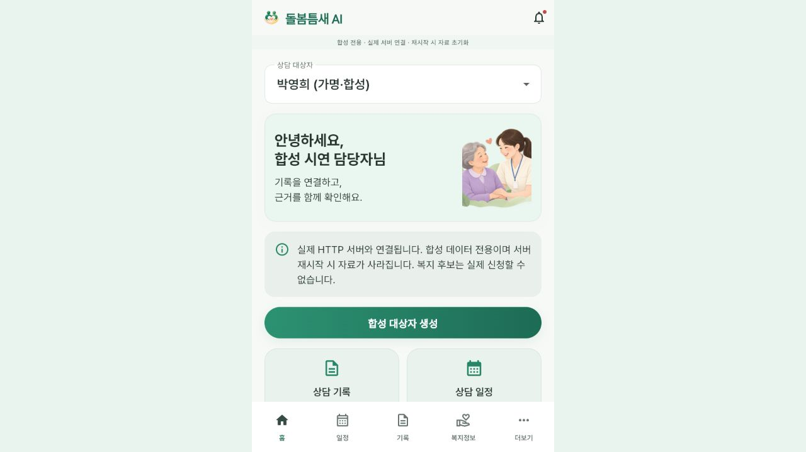

# CareGap 최종 통합·검증 보고서 — 2026-10-30

## 1. 검증 날짜와 환경

2026-10-30 KST, Windows 11, Node 22.15.0, pnpm 11.25.0, TypeScript 7.0.2, Flutter 3.47.4 / Dart 3.13.3. 별도 복제본 `final-verification-CareGap-Backend`, `final-verification-CareGap-Frontend`에서 작업했다. 추가 PR #29는 `final-review-pr29`에서 별도로 검사했다. `sources/`와 다른 작업 브랜치는 수정하지 않았다.

## 2. 최신 main과 검증 코드

최초 재조회 Backend main: `fccb6344fa59168541ccfd171e4637124f291d6f`. 이번 안전 검증 PR #30 병합 후 main: `35348e12dcfbb47c4d8c082b3425171fd4757b65`.

최초 재조회 Frontend main: `d72b94700f8fd83ac77dc3276971a88fa4889b4c`. 이번 안전 검증 PR #5 병합 후 main: `e2431f3858f16fb4ccc2b36adccb2343fc1543de`.

최초 값과 코드 병합 후 값은 모두 GitHub API로 직접 재조회했다. 위 Backend SHA는 최종 코드 검증 대상이며, 문서 전용 후속 PR #31은 그 뒤에 반영한다. 최종 병합 여부와 관측 SHA는 아래 18절을 따른다. 운영 중인 4324의 health release는 `final-9e4be3b`이며 최신 main이나 이번 변경 배포를 뜻하지 않는다.

## 3. 전체 PR 상태와 안전성 검토

Backend #1·#2·#3·#4·#6·#8·#9·#10·#11·#12·#13·#15·#16·#17·#18·#19·#20·#23·#25·#27·#28은 이미 MERGED다. 중복 병합하지 않았다. Frontend #1~#4도 이미 MERGED다. 이번 작업에서는 Backend #30과 Frontend #5를 안전 검증 후 새로 병합했다. 최종 문서 반영은 Backend #31이다.

| Backend PR | 최신 검토 상태 | 판단과 차단 원인 |
|---|---|---|
| #5, #7, #14 (BE3) | OPEN, 이미 main의 조상 | `git merge-base --is-ancestor` exit 0. 변경이 이미 포함되어 중복 병합하지 않음 |
| #21 | OPEN, clean | PostgreSQL 스키마·repository·라우터 초안. 실 PostgreSQL migration/FK/관계 인가를 이번 환경에서 검증하지 못함. 활성 통합 서버의 메모리 저장소를 대체하지 않음. 보류 |
| #22 | OPEN, clean | #21 변경과 데모 하네스를 함께 포함. #21과 중복 부분이 있고 실제 BE1 관계 영속화가 연결되지 않음. 전체 병합 보류 |
| #24 | OPEN, dirty | `src/app.ts`, 의존성/lock, 인증 보안 코드 충돌. x-user-identifier 및 단순 Bearer 식별자 fallback, 평문 secret 저장·재설정, Prisma의 별도 User/관계 모델이 기존 users SQL 계약과 다름. 인증·DB 이행안 없이는 병합 불가 |
| #26 | OPEN, dirty | `src/app.ts`, `tests/integration-security.test.ts` 충돌. Supabase JWT/ID 매핑/FCM·outbox·draft migrations 대규모 변경. BE1 관계·binding 영속 어댑터와 실제 DB·FCM 검증 미완료. 보류 |
| #29 | OPEN, 최신 clean | 작업 중 `34fee7c4` → `aad64a6b5777fa0edd0b57fd20d249d1d4e94615`로 갱신. 최신 추가분은 구형 인증 차단·오류 비노출·Vision 반영이며 Vision 파일은 main과 동일. 재검토한 최신 HEAD의 타입·646개 테스트·빌드 통과. 실제 LiveKit은 `CONFIG_MISSING`. #26의 DB/알림 변경을 포함하며 실제 통화·DB 검증 없이 안전한 전체 운영 통합으로 판정하지 않음 |

#29 최신 diff에서는 이전 충돌이 해소됐고 `git merge-tree`도 성공했다. 따라서 #29를 현재도 충돌이라고 기록하지 않는다. CI 성공과 실제 통화 성공은 별개다. 다른 개발자의 PR을 닫거나 수정하지 않았다.

추가 #29 웹 프로토타입도 npm ci·typecheck·Vite build를 별도로 통과했다. 다만 설치 시 `machina@7.0.1`은 Node >=22.22를 요구하여 현재 22.15.0에서 EBADENGINE 경고가 발생했다. 빌드 성공으로 런타임 호환성·양방향 통화 성공을 보장하지 않는다.

## 4. 기능별 검증표

| 기능 | 판정 | 실제 근거 / 한계 |
|---|---|---|
| 담당자 2명·예약자 2명 로그인 | 완료(격리 합성 서버) | 실제 login/me 및 Flutter 실서버 위젯 4계정 검사 |
| 역할·배정·자기 자료 제한 | 완료(격리) | 교차 대상자 403, patient 임상 쓰기/분석/승인 403, 자기 예약 생성 권한 테스트 |
| 예약·완료·예정 | 완료(격리) | 대상자별 완료 1·예정 1, 총 4건 |
| 프로필 | 부분완료 | 가명, 계정·대상자·담당자 연결. 주소·전화·실 개인정보 없음. 범용 프로필 편집 API 미구현 |
| OCR | 부분완료 | 실제 ONNX CPU 인식 성공. 띄어쓰기 소실, 손글씨 정확도 보증 아님 |
| STT | 부분완료 | 실제 Whisper base CPU int8 성공. 복약·외출 오인식 발견, 교정·확정 이력 보존. 화자 분리 없음 |
| 상담 비교·인용 | 완료(합성 2사례) | 실제 Qwen 출력, 원문 ID/버전/부분 문자열 대조 |
| 검토·승인 | 완료(API 상태 전이) | 담당자 계정으로 자동 검증 실행. 실제 사람의 임상 검토는 아님 |
| 복지 후보 | 완료(합성 후보) | 각 1개, synthetic_demo / unverified. 실제 자격·신청 기능 아님 |
| 인앱 알림 | 부분완료 | 담당자별 1개 실제 저장·조회. 예약자 수신 알림 생성/전달은 미구현 |
| Vision | 부분완료 | PNG/JPEG 실제 HTTP 201, 실제 Ollama 원본 images 전송 확인. 도형 설명 오류가 있어 내용 정확도 미통과 |
| Flutter 실제 서버 경로 | 완료(로컬) | USE_MOCK=false 빌드, 4계정 실제 HTTP 화면 테스트, 실제 Repository 전체 흐름 |
| 카메라/WAV UI | 부분완료 | 기존 카메라→OCR, WAV 선택 유지. 실기기 권한·촬영·마이크 미검증 |
| DB 영속화·운영 인증 | 미완료 | 합성 메모리 서버만 검증. Supabase/DB 운영 어댑터는 별도 |
| FCM/전화 | 미완료 | 실제 기기 수신·양방향 음성 없음, #29 LiveKit 설정 없음 |

## 5. 담당 범위

BE1: 합성 역할 로그인과 배정 인가는 이번 격리 어댑터에 구현·검증. 운영 Supabase 사용자/관계/승인/관리자/가족·비밀번호 복구는 미완료다.

BE2: 격리 예약·완료·기록 버전·후속 업무·인앱 알림은 작동한다. PostgreSQL 및 FCM outbox·worker 실제 운용, 실제 전화는 미완료다. 최신 #29 자동 테스트 646개를 별도로 통과시켰다.

BE3: ONNX OCR, Whisper, Qwen 비교, 인용 검증, 승인 게이트, 합성 복지 후보, 직접 Vision 실제 호출을 검증했다. 인식 오차·Vision 환각은 남아 있다.

Frontend: patient 역할을 beneficiary로 매핑하고 자기 예약·기록 화면을 추가했다. staff에는 기존 OCR/STT를 유지하며 선택적 Vision 버튼을 추가했다. 기본 HTTPS 정책을 유지하고 명시적 빌드 옵션에서만 로컬 루프백 HTTP를 허용한다.

## 6. 실제 서버와 격리 서버

| 위치 | 상태 |
|---|---|
| `http://127.0.0.1:4324` | 기존 서버 보호. 프로세스 종료·재시작·교체·메모리 삭제 없음. 이번 변경과 4계정 시드는 적용하지 않음 |
| 기존 `https://favourite-bizrate-passed-calibration.trycloudflare.com` | 기존 터널 변경 없음 |
| `http://127.0.0.1:4334` | 이번 격리 합성 API. 4계정·데모 데이터 실제 생성 위치 |
| `http://127.0.0.1:4335` | 이번 Flutter 웹 실행. 같은 출처 프록시로 4334 연결. Windows Node 프로세스이므로 Docker 목록에는 표시되지 않음 |
| `https://grams-viewing-given-categories.trycloudflare.com/` | 사용자가 공개 합성 로그인/API 연결을 명시 허용한 새 외부 웹. 4337 전용 프록시→4334. 실제 화면·health·4계정 로그인·전체 Repository 흐름 검증 |
| **최신 간편 로그인: `https://wash-mighty-dust-director.trycloudflare.com/`** | 후속 사용자 요청의 간단 ID·시연 비밀번호 전용. 새 4339 프록시→기존 4334 계정. 실제 4계정 및 브라우저 staff1 로그인 성공. 기존 프로세스·데이터는 유지 |

최초 공개 자격증명 전송 시도는 자동 승인 검토가 거절하여 루프백으로 대체했다. 이후 사용자가 4335 화면 확인과 새 링크를 요청하고, 합성 로그인 정보·데모 API의 Cloudflare 연결을 명시적으로 허용했다. 그 후에만 위 정확한 새 외부 도메인에서 4계정과 실제 API 흐름을 다시 확인했다. QUIC 연결 실패 후 별도 HTTP/2 터널로 성공했다. `USE_SAME_ORIGIN=true` 빌드가 외부 기기의 localhost를 호출하지 않도록 한다. 기존 Docker·Ollama·Cloudflare·.env는 중단·수정하지 않았다. 임시 Quick Tunnel이며 운영 배포로 취급하지 않는다.

## 7. API 요청·응답·HTTP 상태

인증 요청은 identifier/password 계약을 사용하되 실제 값·토큰은 문서와 증거에서 제외했다. 다음은 실제 API 또는 명시된 보안 자동 테스트에서 확인했다.

| 요청 | 응답/HTTP |
|---|---|
| POST `/api/auth/login` | 200 `{data:{access_token,expires_in:3600,actor}}`, 4계정 role 일치 |
| GET `/api/auth/me` | 200 actor; 익명·로그아웃 토큰 401 |
| POST `/api/auth/logout` | 204, 이후 me 401 |
| POST register에 role:admin | 400; 공개 등록은 역할 선택 불가 |
| GET persons | 200 배정 대상자 또는 본인 1명 |
| POST appointments `{person_id,starts_at,ends_at}` | 201 scheduled; 동일 시간 재요청 409; 다른 대상자 403 |
| POST appointment actions `{action:complete,expected_status:scheduled}` | 200 completed; patient 실행 403(자동 테스트) |
| GET records?person_id | 200 자기/배정 자료; 다른 대상자 403 |
| POST OCR/STT jobs `{person_id,request_key,filename,mimeType,base64}` | 202, GET job에서 200 succeeded |
| POST job corrections `{expected_version:0,text/segments}` | 200 version 1, 원문은 별도 보존 |
| POST job confirmation `{expected_version:1}` | 200 confirmed_by/at/version |
| POST records/import `{source,job_id}` | 201; 같은 job 재요청은 같은 record ID |
| POST analyses `{person_id,past:[ref],current:ref}` | 200 succeeded, llm/ollama 및 실제 eval_count |
| POST analysis-reviews `{action,expected_version}` | 200 submit→review→approve→approved |
| POST welfare-recommendations | 200 합성 후보 1개/대상자, 자격 unverified |
| POST vision/analyses + Idempotency-Key | PNG/JPEG 201, provenance.ocr_used=false |
| POST/GET follow-ups, notifications | 생성 201, 조회 200; 타인 알림 읽음 404 |
| patient 임상 쓰기·모델·승인 | 403 (격리 실제 records 및 전 경로 자동 테스트) |

구체적인 합성 요청/응답은 `evidence-2026-10-30/demo-http-trace.json`, `security-http.json`, `frontend-live.json`에 보관한다. 재실행 trace에는 기존 항목 조회가 많으므로 생성 건수는 서버를 다시 조회한 demo-summary를 따른다.

## 8. 실제 OCR/STT/Qwen 결과

OCR 박영희: `오늘식사는세번했고약을빠뜨리지않았습니다.`

OCR 최정호: `오늘식사는두번했고외출은주한번했습니다.`

Whisper 박영희: `합성 상담입니다. 오늘 식사는 세 번 했습니다. 약을 빡들이지 않았습니다. 산책은 일주일에 두 번 했습니다.`

Whisper 최정호: `합성 상담입니다. 오늘 식사는 2번 했습니다. 후에 줄은 1주일에 한 번 했습니다.`

위 오인식 원문을 숨기지 않고, 알려진 합성 대본으로 교정한 후 확정했다. 원문 성공과 무교정 정확도를 동일시하지 않는다.

Qwen `qwen2.5vl:7b`: 박영희 식사·복약·산책 improved 3항목, 최정호 식사·외출 worsened 2항목. 최초 시드 비교 추론 eval_count는 각각 181/146, elapsed_ms 4698/3495였다. 모든 인용은 실제 저장 record_version/consultation과 대조했으며 일치했다. 모델 결과를 미리 합성해 성공으로 저장하지 않았다.

## 9. 이미지 직접 Qwen 분석

별도 합성 도형 이미지 PNG/JPEG를 사용했다. HTTP API 두 형식 모두 201이다. 별도 실제 provider 호출에서는 fetch를 관찰한 후 실제 Ollama로 전달하여 `/api/chat`, `messages[1].images[0]`와 원본 파일 base64의 바이트 동일성을 assert했다. OCR 호출·텍스트 선처리 없이 이미지가 전달됐다. 실제 응답은 `vision-evidence.json`에 있다.

내용 정확도는 부분 실패다. 실제 그림은 파란 사각형 1개, 흰 타원 안에 녹색·주황색 타원 2개인데, PNG 응답은 “두 개의 원형”, “왼쪽의 원형은 파란색”이라고 기술했다. 사람 검토 필수이며 자동 상담 기록 채택·승인하지 않았다. Flutter의 Vision은 기존 OCR 버튼과 별개다. 4324 배포 여부를 이 결과로 추정하지 않는다.

## 10. 정확히 4개의 실제 로그인 계정

| 가명(모두 합성) | 역할 | user_id | 대상자 연결 |
|---|---|---|---|
| 김민준 | staff | `9adbcd38-0ba7-4b94-83e1-df081a59562a` | 박영희 |
| 이서연 | staff | `ccf1b7d8-8c2d-4164-90ec-de1dce83edb4` | 최정호 |
| 박영희 | patient | `3bc0a3f5-c612-40ee-8406-a2ade8678053` | person `ddedb157-efa8-4e28-ba57-2e32bd5bbfa7` / 김민준 |
| 최정호 | patient | `a3484420-d4c5-4185-b625-0040590c6f19` | person `b98d8c10-5360-419c-b967-29d2aaac4d0c` / 이서연 |

생성 위치는 모두 4334다. 담당자 2/2, 예약자 2/2 실제 로그인했다. 비밀번호는 randomBytes(24)로 생성했고 API 내부에는 salted scrypt hash만 보관한다. 공개 회원가입으로 patient/admin을 선택할 수 없다. 예약자 배정은 신뢰하는 로컬 bootstrap 파일만 읽는다.

자격증명 파일: `C:\Users\Owner\.codex\.chatgpt-projects\g-p-6acee141f5688191bba69532c656eca2\final-verification-CareGap-Backend\.runtime\demo-credentials.json`. Git ignore이며 NTFS ACL을 현재 사용자만 접근하도록 제한했다. 문서·소스·커밋에 실제 password/token을 넣지 않았다.

후속 사용자 요청으로 새 간편 로그인 경로를 추가했다. `staff1`=김민준, `staff2`=이서연, `user1`=박영희, `user2`=최정호다. 요청한 공통 시연 비밀번호는 Frontend 복제본 `.runtime/demo-login-aliases.json`에만 보관하며 Git/브라우저 번들에 넣지 않았다. 새 4339 로그인 게이트웨이가 이 4개 별칭을 기존 4334의 정확한 계정에 연결하므로 user_id·배정·예약·기록과 계정 수 4개가 그대로 유지된다. **기존 4334의 비밀번호를 직접 변경한 것은 아니며 간편 로그인은 최신 링크에만 적용된다.** 일반 회원가입의 길이 제한과 직접 4334 인증 계약은 유지했다.

별칭 파일 ACL은 현재 사용자만 허용한다. 실제 검증: 간편 4로그인 성공, 잘못된 비밀번호 401, role 주입 401, 외부 Origin 403, 비밀 파일 URL 404. 전용 로그인 빌드만 짧은 입력을 허용하고 로그인 시도는 분당 30회로 제한한다. `frontend-simple-live.json`, `simple-login-security.json` 및 아래 실제 화면이 증거다.

## 11. 실제 데모 데이터와 멱등성

대상자 2명, 배정 2쌍, 예약 4건(완료 2·예정 2), 상담 기록 8건(박영희 5·최정호 3: 과거 각 1, OCR/STT 확정 현재 기록 및 Flutter 추가 검증 기록 포함), 후속 업무 2건, 인앱 알림 2건이다. 초기 시드의 기록은 6건이며 Flutter 실제 OCR/STT 가져오기 검증으로 2건 추가됐다.

최초 시드 분석 2건은 승인 상태이며 합성 복지 후보 각 1건을 반환했다. 자동 담당자 계정 검토 기록을 실제 사람의 승인으로 표현하지 않는다. OCR/STT 초기 작업 각 2건과 Flutter 추가 작업 각 1건에 교정 version 1 및 confirmed 이력이 있다. 합성 한국어 WAV 2개, OCR PNG 2개, 별도 Vision PNG/JPEG 각 1개를 `.runtime/`에 생성했다.

Flutter가 OCR 현재 기록을 선택한 추가 비교 1건을 포함해 실제 승인 분석 ID는 총 3개다(반복 요청은 기존 분석을 재사용). 알림 2건의 수신자는 각 담당자 계정이다. 예약자 수신 알림 1건씩을 충족했다고 주장하지 않으며, staff가 승인된 subject의 patient recipient로 전송하는 API는 후속 구현 사항이다.

`prepare-four-accounts.ts`는 기존 로컬 파일을 재사용하며 `seed-four-demo.ts`는 예약 시간·원문·작업 request_key·import·업무/알림 제목을 조회/재사용한다. 동일 시드를 반복 실행해도 사용자·예약·기록 수가 늘지 않는 것을 실제 재조회로 확인했다. 분석은 실제 성공 결과만 저장한다. 중단 후 재개 시 완료된 단계는 재사용한다. 시드를 동시에 두 번 실행하는 병렬 경쟁까지 보장하는 분산 멱등 저장소는 아니다.

## 12. 자동 테스트

| 검증 | PASS | FAIL | SKIP/미실행 |
|---|---:|---:|---|
| 이번 Backend 전체 | 542 | 0 | 0 |
| 추가 PR #29 최신 HEAD 전체(별도) | 646 | 0 | 0 |
| Flutter 전체 최종 | 42 | 0 | 0 |
| Flutter 실제 4334 서버 4계정 위젯 | 1 | 0 | 0 |
| 간편 로그인 매핑·오류·권한 주입 Node 테스트 | 1 | 0 | 0 |
| 실제 LiveKit smoke | 0 | 0 | CONFIG_MISSING, 미검증 1 |

Backend typecheck/build 통과, Frontend analyze 문제 없음, USE_MOCK=false web build 통과. 646개를 최종 main의 테스트 수에 합산하지 않는다.

진행 중 실패도 기록한다. Flutter Vision mock 응답의 Latin1 한글 인코딩 오류 1건은 합성 fixture 인코딩 수정 후 최종 42개 통과. 최초 시드 재실행의 confirmed 필드명 오류와 이미 승인된 분석 재승인 409는 재사용 상태 분기로 수정 후 재실행 통과. 첫 웹 빌드는 web 플랫폼 파일 부재로 실패했고 web 파일 추가 후 성공했다. 첫 실제 위젯 검사에서 fake async 파일 읽기를 runAsync로 수정한 뒤 4계정 화면 검사가 통과했다. 이 초기 실패를 최종 PASS 수에 섞지 않는다.

## 13. CI와 링크

- 기준 Backend main verify: https://github.com/KMU5881193/CareGap-Backend/actions/runs/40967219321 — success.
- 기준 Frontend main Flutter: https://github.com/KMU5881193/CareGap-Frontend/actions/runs/40963567458 — success.
- 추가 #29 최신 verify: https://github.com/KMU5881193/CareGap-Backend/actions/runs/40969215444 — success.
- 이번 Frontend #5: https://github.com/KMU5881193/CareGap-Frontend/pull/5 — 신규 CI 최종 상태는 18절 후속 기록 참조.

GitHub Flutter CI의 APK는 USE_MOCK=true 빌드다. 실제 모델 검증은 위 로컬 별도 실서버 증거이며 CI APK 빌드로 대체하지 않는다.

## 14. 실기기

`flutter devices --machine`에는 Windows/Chrome/Edge만 있고 Android/iOS 실기기가 없다. Android 카메라·WAV 녹음 권한·실제 스피커/마이크·FCM 잠금 화면·양방향 음성은 미검증이다. 위 실제 서버 위젯 테스트와 실기기 검증을 구별한다.

## 15. 미완료 보안·인증·DB·FCM·전화

합성 opt-in 메모리 인증은 운영 사용자 디렉터리가 아니다. 운영 staff 승인, 가족 링크·동의, 영속 subject 관계, 감사 로그, 계정 복구·비밀번호 변경, durable sessions, DB migration 적용·rollback 검증이 남았다. 기존 구형 인증 표면은 fail-closed를 유지한다. FCM 서비스 계정·토큰·outbox worker 운용 및 실제 전송은 미검증이다. #29의 LiveKit 프로토타입은 별도 예시이며 integrated-app 또는 4324의 작동하는 전화 기능이 아니다.

## 16. 프론트팀 즉시 연결 순서

1. 이번 로컬 시연은 4335 웹 / 4334 API를 사용한다. 기존 외부 터널과 혼동하지 않는다.
2. 로컬 비밀 파일의 staff/patient 계정으로 login → me → persons → appointments/records를 조회한다.
3. staff만 OCR/STT 작업 생성 → 폴링 → 원문 검토 → corrections(expected_version) → confirmation → records/import.
4. 과거·현재 ref로 analyses를 생성한다. 원문 인용 대조 후 submit → approve. 분석 version을 매번 최신 응답으로 교체한다.
5. 승인본의 근거를 직접 확인한 후 welfare-recommendations를 호출하고 합성·자격 미확인 표시를 유지한다.
6. 선택 Vision 버튼은 `/api/vision/analyses` + Idempotency-Key, JPEG/PNG base64로 직접 분석한다. 사람 검토 전 자동 채택하지 않는다.

## 17. 시연 전 필수 작업과 데이터 보존

실행 중인 4324와 이번 4334/4335를 재시작하지 않는다. 4334는 메모리 저장소다. 현재 계정 bootstrap 파일과 `.runtime/demo-seed-state.json`, 원문·추론·HTTP 증거를 보존하되 자격증명은 외부에 공유하지 않는다. 기존 4324의 사용자 생성 자료 전체를 내보내는 API는 없으므로 완전 백업을 확인하기 전 교체 배포하지 않는다.

처음부터 격리 시연을 재구성해야 할 때에만: `pnpm install --frozen-lockfile` → `node --import tsx scripts/prepare-four-accounts.ts` → `pwsh -NoProfile -File scripts/four-demo-assets.ps1` → 기존 OCR venv Python으로 `scripts/four-demo-images.py` → 비어 있는 4334에서 `scripts/start-four-demo.ps1` → health 확인 → `node --import tsx scripts/seed-four-demo.ts`. start 스크립트는 사용 중인 포트에서 실패하며 기존 서버를 종료하지 않는다. 이 재구성은 4324 데이터의 완전 복원 절차가 아니다.

운영 이행은 영속 DB·관계 인가·전체 데이터 export/복원 검증 → 별도 포트 canary → 프론트 주소 전환 → 데이터 동기화/rollback 검증 순으로 별도 승인 후 수행해야 한다. 이번에는 실행하지 않았다.

## 18. 실제 병합과 신규 PR

Backend 신규 PR https://github.com/KMU5881193/CareGap-Backend/pull/30 — 구현 `6c90167aaa3b8e781822f79849b020608f6a444b`, 두 verify CI success 및 보안·실제 API 검증 후 병합. 실제 merge SHA `35348e12dcfbb47c4d8c082b3425171fd4757b65`.

CI: https://github.com/KMU5881193/CareGap-Backend/actions/runs/40970818211 및 https://github.com/KMU5881193/CareGap-Backend/actions/runs/40970827003 — success.

Frontend 신규 PR https://github.com/KMU5881193/CareGap-Frontend/pull/5 — 구현 `4854439`, 외부 같은 출처 수정 `d5b3651374beed6136cc4c07241489313bdf5efa`. 최초 구현 CI는 전체 success, 외부 수정 뒤 최신 CI는 최종 후속 기록을 따른다. 변경 후 로컬 analyze·42 tests·외부 HTTPS 전체 API 검증은 통과했다.

최신 외부 수정 CI: https://github.com/KMU5881193/CareGap-Frontend/actions/runs/40971302052 및 https://github.com/KMU5881193/CareGap-Frontend/actions/runs/40971309773.

간편 로그인 최종 구현 `c4635015fb9e42598cf325f29bbe21bf64ee3dbd`의 CI: https://github.com/KMU5881193/CareGap-Frontend/actions/runs/40972076048 및 https://github.com/KMU5881193/CareGap-Frontend/actions/runs/40972068762. 기존 프론트 PR #5에 추가했으며 최종 병합 상태는 아래 후속 기록에 남긴다.

최종 확정: Frontend #5는 위 두 Flutter CI와 두 verify CI 모두 success 후 MERGED. 실제 merge SHA는 `e2431f3858f16fb4ccc2b36adccb2343fc1543de`다. 분석·42개 Flutter 테스트·Node 별칭 테스트·APK 빌드가 통과했다. APK CI는 mock 빌드이며 실서버 검증은 별도 실제 웹/Repository/HTTP 증거로 충족했다.

최종 보고서 후속 PR: https://github.com/KMU5881193/CareGap-Backend/pull/31. 코드 PR #30 이후의 보고서·handoff·합성 화면 증거만 반영한다. 문서 커밋 자체를 그 문서의 검증 코드 SHA로 표시하지 않는다. 보고서의 Backend 코드 검증 기준은 `35348e12dcfbb47c4d8c082b3425171fd4757b65`, Frontend 기준은 `e2431f3858f16fb4ccc2b36adccb2343fc1543de`다.

## 19. 남은 위험과 우선순위

P0: 4324 메모리 보존, 합성·운영 서버 혼동 방지, 자격증명 비공개, 배정/자기 자료 인가 유지. 시연자가 STT 교정과 Qwen 인용·Vision 내용을 직접 확인해야 한다.

P1: 운영 인증·관계·DB 영속화, #24의 인증 우회/평문 secret 제거와 migration 일원화, #26/#29 실제 PostgreSQL·FCM·LiveKit 검증 및 별도 앱 통합. 실제 복지 데이터·자격 판단은 아직 제공하지 않는다.

P2: Android/iOS 카메라·녹음·권한·백그라운드 푸시·통화 실기기 검증, 분석/추천 이력 목록 API, 환각 평가 확대, 시드 병렬 실행에 대한 durable idempotency.
